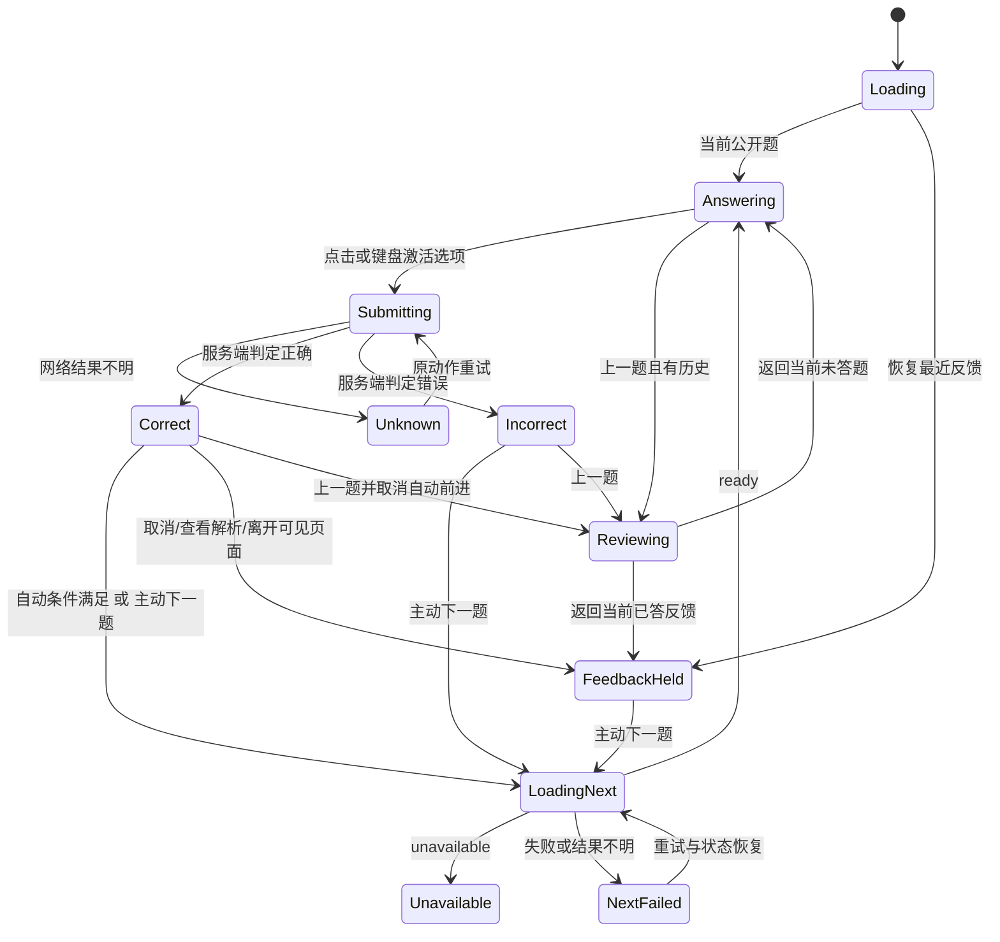

# Web 前端交互设计：Ant Design

日期：2026-09-11。核对代码基线：`89305a6`。设计修订：`web-design-v1.1`。状态：设计与模块任务交付，尚未迁移运行中的前端。配套 [独立模块实施计划](12-web-implementation-plan.md) 和 [增量接口/E2E契约](13-web-api-and-e2e-contract.md)；接口细节以 13 为准。

本方案依据现有产品文档、练习/考试接口及页面代码，并结合 SurveyKing 官方资料和用户参考图。用户已确定采用 Ant Design，视觉保守克制、企业风格；练习点击单选项即校验，答对可自动进入下一题，答错停留；考试的提交操作仅保留交卷。

这项新决定替代 [01 文档 E12](01-product-and-decisions.md) 中「原生 ES modules/CSS、无 Node 构建链」的前端技术方向。旧冻结文件保留为历史基线；本设计不重写冻结哈希，不改变既有选题、纠错、评分规则。正式迁移时同步实施计划与依赖文档。

## 1. 核心决策

| 事项 | 设计决定 |
| --- | --- |
| 技术栈 | React + TypeScript + Ant Design；Vite 编译，Go 提供同源静态资源与现有 API |
| 视觉 | 浅灰页面、白色内容面、深灰文字、小圆角、细边框；蓝色只强调主要动作与当前状态 |
| 练习作答 | 点击选项立即发起服务端校验；不设置「提交答案」按钮，也不设置选中待确认阶段 |
| 自动前进 | 「答对自动下一题」默认开启；服务端确认正确且反馈已显示 0.5 秒后，只执行一次 next |
| 错误反馈 | 原位保留题干、四个选项、错选/正确标记与展开的解析；无跳题定时器 |
| 手动继续 | 正确和错误反馈都保留「下一题」；错误无需再确认、无需强制读满时间 |
| 提交后修改 | 本题选项只读；无撤销、重选、同题立即重答 |
| 练习导航 | A 上一题、D 下一题；已答题只读回看，新题仍按后端游标向前发出，当前未答时不跳过 |
| 选项快捷键 | 1、2、3、4 分别对应 A、B、C、D；字母 A/D 专用于导航，B/C 不再选择答案 |
| 考试导航 | 固定题卡、上一题、下一题、任意跳题、清除选择；交卷前不显示对错 |
| 考试作答 | 点击选项立即记录并保存，可改选；没有逐题提交按钮，唯一提交操作是「交卷」 |
| 恢复 | 恢复未答题或最近反馈；刷新后的反馈一律先停留，不再次自动跳题 |
| 统计语言 | 「本轮答对」「待巩固」「证据不足」；不使用「已掌握率」「完成每日目标」 |

练习只有单选，选项激活本身就是完整作答动作。点击、触摸、1–4 快捷键，或聚焦选项后按 Enter/Space，都直接校验，不增加第二次确认。底部显示上一题/下一题与答对自动前进设置；首题禁用上一题，当前未答时禁用下一题。技术文档中的 submit/attempt 仍指服务端记录作答的请求，不代表界面上存在独立提交步骤。

## 2. 参考来源与当前代码结论

[SurveyKing 调研记录](research/2026-09-11-surveyking-interaction.md) 列出了原始证据与采纳边界。官方明确支持一页一题与提交后对错/解析；自动前进的精确条件和时序是本项目设计，不声称已从公开客户端验证。

| 现状 | 证据 | 对设计的影响 |
| --- | --- | --- |
| 已有 Go 模板、原生 JS/CSS，页面导航重复 | `web/templates/*`、`web/static/*` | 迁移需共享壳层、API 客户端、状态模型，而不仅替换按钮样式 |
| 单题四选一，提交后返回答案与解析 | `internal/practice/types.go:19,51,59` | 激活选项即调用 attempts；反馈以服务端判定为准，前端不预藏答案 |
| 提交成功立即 cursor + 1 | `internal/practice/service.go:803` | 界面仍可停留在上一题反馈；不能用 cursor 直接决定所显示题号 |
| next 是保留实例的写操作 | `internal/practice/service.go:294` | 反馈停留时不能预取下一题；实际前进时再发 next |
| 现有恢复只查当前 cursor | `internal/practice/service.go:234` | 答后 cursor 已推进时通常没有上一题反馈，需修正恢复契约 |
| 反馈 DTO 不含题干、实例、用户选项 | `internal/practice/types.go:60` | 仅凭 last_feedback 无法还原完整错误页，不能把 UI 缓存当权威恢复 |
| 前端忽略 last_feedback，直接 next | `web/static/practice/practice.js:219` | 需改为显式回答/反馈恢复分支 |
| 当前 submit 失败后允许换选项，并新建重试 key | `web/static/practice/practice.js:345` | 网络结果不明时应锁定原动作，保留原 key 和正文 |
| 考试事件队列返回不代表全部确认 | `web/static/exam/exam.js`、`docs/frontend-api.md:138` | 交卷需要检查队列水位和 unknown 项 |
| 考试题目/解析使用 innerHTML 插值 | `web/static/exam/exam.js:393,611` | React 按文本渲染；不用 dangerouslySetInnerHTML |
| 一些管理接口与资源发现入口尚缺 | `docs/frontend-api.md:159` | 未实现能力明确列为后续任务，不画成现成功能 |

## 3. 信息架构与进入路径

全站稳定入口为「题库」「自适应练习」「阶段考试」「内容管理」。内容管理内分「词表导入」「内容生成」「质量与维护」。保留首页作为轻量入口，展示活动会话和最近选用题库，不堆叠学习 KPI。不加入账号头像、组织切换、权限菜单、消息中心或团队统计。

| 页面 | 路由 | 首要任务 | 主要组件 |
| --- | --- | --- | --- |
| 首页 | `/` | 继续活动会话；进入题库 | Card、Alert、Button |
| 题库列表 | `/banks` | 选题库开始练习或考试 | List/Card、Input.Search、Tag |
| 题库详情 | 保留现有详情路由 | 摘要、可用题型数量、成员与归档 | Descriptions、Table、Modal |
| 练习入口/作答 | `/practice?bank_id=…` | 恢复会话或开始练习 | QuestionPanel、Button 选项、Alert |
| 创建考试 | `/exams/new` | 题库、题量、限时 | Form、Select、InputNumber |
| 考试 | `/exams/{id}` | 选择、改答、保存、交卷 | QuestionPanel、AnswerSheet、Progress |
| 考试结果 | `/exams/{id}/result` | 总结与逐题回看 | Descriptions、Table、Collapse |
| 导入/生成/质量 | 保留 `/imports`、`/generation`、`/quality` | 完成各管理任务 | Form、Upload、Steps、Table、Drawer |

启动时查询服务可用性、client-context、维护状态与活动会话，再决定加载哪个页面。出现已有会话时，入口主按钮变为「继续练习」或「继续考试」。考试恢复链接必须是 `/exams/{id}`。

若试图在其他题库或另一种模式新建会话，展示活动会话的题库、类型和「继续当前会话」主动作；次要动作「结束当前会话后重新选择」必须先走当前会话合法结束流程。考试的放弃具有丢弃本次成绩的语义，不能套用练习结束文案。

题库初次为空：展示 Empty，主操作「新建题库」，其次「导入词表」。已归档题库保留查看入口但禁用新练习/组卷。成员数不能承诺为可组卷题数。

## 4. 练习页面布局

桌面基准宽度 1440，内容最大宽度 1200，水平居中；全局顶栏高 56。面包屑和页面标题区后进入两列：左栏 216、间距 24、右侧自适应，答题内容的有效行宽尽量在 640–840 之间。

```text
全局顶栏    Adaptive Vocabulary    题库   自适应练习   阶段考试   内容管理
面包屑      题库 / 基础词汇 / 自适应练习
页面标题    自适应练习                              保存并离开  结束练习

答题卡                  第 8 题 · 语境选择                  待作答
已答 7 · 答对 5
[1 ✓][2 ×][3 ✓]           题干
[4 ✓][5 ×][6 ✓]           A  选项全文
[7 ✓][8 当前]            B  选项全文
                         C  选项全文
                         D  选项全文
                         反馈与解析（点击选项校验后出现）
                         ────────────────────────────
                         上一题 (A)  下一题 (D)  答对自动下一题 [开]
                         1–4 作答 · A 上一题 · D 下一题
```

答题卡显示「已答、答对、答错」计数与本轮已出现的题号，不预放未来空号。题号为可点击按钮：点击已答题只读回看，点击已经保留的当前未答题返回继续作答；不改变服务端游标，不发新题、不重判、不重复计分。点击题卡立即取消自动前进，即使点击当前题号也停留阅读。校验中、结果待确认、结束中锁定题卡导航，避免丢失在途操作。

未答题用白底灰框，答对用浅绿底和 ✓，答错用浅红底和 ×；当前查看题另加蓝色边框，保留其对错底色与图标。当前位置与作答结果是两个独立状态，不能互相覆盖。题卡提供文字图例及每题 aria-label，当前项使用 aria-current。统计缺失时显示「记录加载中」或隐藏细分统计，不能填 0。每页 30 条，支持稳定分页、标注范围及定位当前题；上一题/下一题跨页时通过状态分页与单题历史接口读取，已获取题目缓存在会话内存中，不丢弃旧题。跨页查看早期题目时，答题卡提供常驻「回到当前题」锚点，点击可快速重定焦至最新未答题或最近反馈。跨会话历史列表属于后续功能。

桌面答题卡位于左侧，窄屏收为清晰的「答题卡」入口，打开后展示同一套计数与题号。考试答题卡展示完整固定试卷；交卷前仅展示未答、已答、当前和待同步，不泄露对错。交卷后结果页才用绿色/红色显示评分。

### 4.1 本轮回看与继续

「上一题」或 A 查看前一题，展示当时选择、对错和解析，所有选项只读；数字键在回看页无作答效果。回看不新增 attempt、不重判、不增加已答数。界面标明「回看 · 只读」。

「下一题」或 D 在回看时向后查看已有记录，最终回到保留的当前题；这个过程不调用 next，也不重新计分。回到未答题时保持未答，可按数字键作答；回到已答反馈时保持停留，不重启自动跳转。只有在最新已答题上主动前进，才请求一条新的自适应题。

最新题未答时 D 不跳过，提示「请先完成当前题」；仍可 A 回看再 D 返回。首题 A 无动作。无候选页可 A 回看最后一题；D 不循环发题或自动结束。校验中、结果待确认或结束处理中冻结导航，先解决原请求。离开当前反馈查看历史时立即取消自动前进，并使旧计时回调失效。快速连按 A/D 切换回看时，采用 200–300ms 停留防抖后再将展示审计事件存入 outbox，避免短时间事件堆叠引起后续新作答的排空等待。

正式接入需补齐本轮历史查询及独立展示审计，见第 13 节及 [接口契约](13-web-api-and-e2e-contract.md)。回看不直接更新 FSRS/冷却；报告不能把回看后的作答宣称为无提示观测。当前预览只用内存示例演示导航，不代表现有后端已经支持完整历史回看。

记录区依赖新增服务端会话摘要，不能以 `answeredCount` 的浏览器内存计数代替可恢复统计。口径为本会话唯一 accepted attempt，包含普通、提前复习和纠错的原判定；未答不计错、重试不重复计数。答对数和逐题状态不能由 cursor 猜测，这不是有效学习证据或掌握率统计。

题型标签只用「词义识别 / 反向选择 / 语境选择」，不显示词义 ID、form ID、FSRS、纠错队列位置。当前 PublicQuestion 不含 purpose；在接口明确提供前，不能自行标成「提前复习」或「纠错题」。

题干不拆取未经契约定义的子字段；对英文正文保留自然换行，语境句保留空缺，不在未提交状态额外展示释义、解析、目标词提示或词典链接。

## 5. 答题状态与操作矩阵

| 状态 | 选项行为 | 主操作 | 提示/反馈 | 自动前进 |
| --- | --- | --- | --- | --- |
| loading | 不显示可选答案 | 加载中，禁用 | Skeleton 保留布局 | 否 |
| unanswered | 点击任一选项立即校验 | 四个选项就是作答入口，无额外按钮 | 点击选项即作答 | 否 |
| submitting | 立即锁定所有选项，保留本次点击状态 | 无额外按钮 | 正在校验… | 否 |
| submit-unknown | 锁定原选择 | 重试确认 | 提交结果待确认，请勿重复作答 | 否 |
| correct-feedback | 只读，正确项带 ✓ | 下一题 | 回答正确；已保存 | 符合条件时 0.5 秒后 |
| incorrect-feedback | 只读，错选 ×、正确 ✓ | 下一题 | 回答错误；你的答案…；正确答案…；展开解析 | 永不 |
| reviewing | 已答题只读，数字键无动作 | 下一题，返回已有记录或当前题 | 回看 · 只读；显示原答案和解析 | 永不 |
| loading-next | 原反馈仍可阅读 | 正在准备下一题… | 必要时显示 Spin | 已锁定一次操作 |
| next-failed | 原反馈仍可阅读 | 重试下一题 | 下一题暂时未能加载，作答已保存 | 不反复自动请求 |
| unavailable | 无可作答题 | 结束本轮练习 | 说明后端原因；可手动重新检查 | 否 |
| ending | 锁定写操作 | 正在结束… | 保留会话内容 | 否 |
| completed | 本轮结果只读 | 返回题库 | 已结束；已答题保留；未完成纠错数量 | 否 |

自动前进切换和查看解析是低优先级操作。底部导航区域位置固定，上一题为次要按钮；下一题只在允许前进时可用，待作答与校验中禁用。选项不替换成前进按钮，避免一次双击先作答又误触下一题。



## 6. 答对自动下一题：完整时序

1. 用户点击或键盘激活一个选项，立即锁定当前题并进入校验中。先保存待确认动作（path、body、key、submission_id、instance_id），再发送请求；没有额外确认步骤。
2. 成功反馈返回后，用服务端 `correct` 判定状态，更新游标/版本、保存反馈。只在新反馈首次展示后启动自动前进。
3. 显示浅绿色的「回答正确」与正确项勾号。底部主按钮保持「下一题」，旁边显示「即将进入下一题 · 留在本题」。不做每 100ms 更新的数字倒计时。
4. 默认延迟 500ms，从反馈真正渲染并且页面可见时开始。根据用户对预览切题偏慢的反馈，将最初的 1200ms 缩短为 500ms；这是本项目的交互节奏选择，不是后端规则或研究结论。用户主动点击「下一题」时跳过剩余停留时间。
5. 定时器到点重新检查状态、实例和会话仍一致，确认没有弹窗、请求、导航、异常或暂停条件，然后进入统一的 `advance()`。
6. `advance()` 先取消定时器并判断查看位置：回看时只切换已有记录；处于最新已答题时获取互斥锁，随后只发送一个 `/next`。点击、D、Enter 和定时器竞争时也只能前进一次。
7. 等待下一题时保留旧题反馈，主按钮显示 loading；ready 后替换题面、清除选择，并将视线/键盘焦点移到新题标题。

选项的第一次有效激活同步获取互斥锁，后续双击、其他选项点击和按键重复不产生新动作。使用当前 instance_id 与操作 token 校验异步响应，旧题响应不能改写新题。已显示正确/错误反馈后仍锁定原题选项；网络结果不明时只允许确认同一个原动作，不解锁改选。

以下动作取消本次计时：关闭开关、点击「留在本题」、展开解析、选择解析文字、在反馈区域开始键盘交互、打开记录/帮助/结束弹窗、页面隐藏、离开页面、会话关闭、维护或请求异常。取消后当前反馈停留；重新打开开关只影响之后的新正确反馈，不追溯触发。

开关按浏览器保存偏好，例如 `avocab.ui.practice.autoAdvanceCorrect.v1`；存储不可用时使用本次会话内偏好，不影响提交。结束后下一会话继续使用偏好。恢复的反馈与回看反馈绝不自动前进。

不提前调用 `/next` 来“优化速度”：当前 next 会保留新实例并影响后续调度，只有用户或计时器真正进入下一题时才能执行。前进失败后保持反馈，用户可以重试、保存离开或结束。

### 6.1 切题响应速度

预览取消原有 250ms 模拟校验和 250ms 模拟下一题等待，只保留正确反馈的 500ms 停留。手动下一题直接切换本地示例题；答错反馈立即显示并停留。缩短间隔后仍忽略双击的后续 click 和按键重复，防止连带作答下一题。

正式客户端在点击选项时立即发送作答请求，在主动前进或反馈停留结束时立即请求 next；响应一到就渲染，不加最小加载时间或过渡动画等待。请求期间保留原反馈；主操作立刻锁定，可在请求持续 150ms 后再显示文字 loading/Spin，快速响应不闪过完整加载页。150ms 只控制提示出现，不延迟请求与题目展示。

当前后端 next 主要是同步 SQLite 查询、选题和实例保留，没有在线 LLM 调用或固定 sleep。大题库的选题查询仍可能影响延迟，实际请求耗时尚未测量。正式接入时分别记录点击到反馈、next 请求、响应到题面可操作的耗时，再优化真正慢的部分；不把本地预览速度当作后端性能实测。

## 7. 答错停留与反馈阅读

错误反馈在当前选项下方展开，不使用 Toast 或弹窗代替。用户选错项使用浅红背景、红色叉号和「你的答案」文字；正确项使用浅绿背景、绿色勾号和「正确答案」文字。正文仍用深灰，长选项允许换行，所有选项都保持可读。

解析区结构：结果行 → 你的答案/正确答案 → 服务端解析原文。解析未提供时显示「本题暂无解析」，不由在线模型临时生成。只显示 API 真正提供的解释，不虚构每个干扰项理由。

错误题不会创建任何自动跳题定时器。底部「下一题」在反馈保存后即可点击；旁边提示「阅读解析后继续」。用户也可以结束练习，未答的新题不会记错。

不在反馈页安排原题重选。后端会按已有策略，在满足词间隔且存在合格新形式时安排纠错。文案为「后续会根据间隔和可用题目安排巩固」，不能承诺下一题立刻重测，也不能承诺本轮一定有纠错题。纠错正确不显示“已掌握”。

## 8. 恢复、离开与边界情况

### 8.1 恢复优先级

有本地 unknown 动作时先协调该动作与服务端状态，避免立即发新题。随后以服务端会话详情为准：

1. 终态：显示结束摘要或考试结果入口，不恢复为 open。
2. 存在未答 `current_question` 且无待确认动作：展示该题，所有选项未选中；不存在「已经选中但尚待提交」的练习草稿。
3. 无未答题且有最近已答题与反馈：恢复完整反馈页，开关保留但不启动自动前进。
4. 新会话 `cursor=0` 且无题：请求 next。
5. `cursor>0` 但恢复资料不完整：进入恢复异常态，重新读取/重试原提交；不悄悄跳过错误页。

`cursor` 代表服务端答题进度，`activeQuestion` 是已经保留的最新题，`displayedQuestion.ordinal` 代表当前查看位置，`ui.phase` 决定允许动作。回看只改变显示位置，不回退 cursor，不覆盖 activeQuestion；恢复后优先进入当前题或最近反馈，历史查看位置不自动揭示旧解析。

### 8.2 保存并离开 / 结束练习

「保存并离开」在无待确认写入时返回题库，会话保持 open，下次主入口为继续。尚未点击选项的题保持未答；点击后尚未确认的请求必须作为原动作持久化并恢复，不能当作未提交选择丢弃。作答及展示审计 outbox 的正文、key、状态必须可跨刷新恢复，详见 [13 的写入契约](13-web-api-and-e2e-contract.md)。若存在未知写入，先显示确认中，不承诺已同步。关闭标签页不会隐式 end，也不依赖 unload 请求保证写入。

「结束练习」打开 Modal：标题「结束本轮练习？」；正文「已完成的作答会保留，尚未作答的题目不计入结果。」主按钮「结束练习」，次按钮「继续练习」。先取消自动前进；校验中或提交结果待确认时先解决当前动作，不与 end 并发。使用最新 revision 和固定操作 key，未知结果先恢复确认；成功才进入摘要。

### 8.3 无候选、断网、维护与多标签页

| 情况 | 界面行为 |
| --- | --- |
| 无候选 | 显示服务端 reason/counts；说明不是失败，不自动结束 |
| 词间隔不足 | 「当前题库暂无符合间隔要求的题目」；不显示时间倒计时，因为间隔可能按完成不同词计数 |
| 缺少题目内容 | 显示内容不足；主操作结束本轮，再从内容管理补充，避免活动会话期间打开答案管理页 |
| 等待/重新检查 | 仅手动重新检查或已知内容/状态变化后重查；不循环请求，不承诺单纯等几分钟就有题 |
| 提交超时 | 原选项保持锁定；「提交结果待确认」与「重试确认」；保留同 key、同正文 |
| 服务重启/CSRF 拒绝 | 明确 CSRF_REJECTED 后刷新 context，再按原动作重试 |
| 版本冲突 | 取消计时，读取会话；按当前题/反馈/终态恢复，自动恢复最多有限次数 |
| 多标签页 | 通过 BroadcastChannel 等提示「另一页面正在作答」；服务端 CAS 仍是最终防线，不凭本地锁判定写入成功 |
| 维护 | 全局 Alert，保留只读内容、禁用写操作；维护恢复后重新读会话 |
| 练习记录缓存丢失 | 从服务端恢复；若 API 尚未补齐则明确缺失，不展示虚假的完整记录 |

## 9. 阶段考试流程

创建页只包含题库、题数、限时三项必要条件。默认建议 20 题/20 分钟作为可修改初值；题库规模不足时不保证该数量可组卷。当前后端上限默认 200 题，限时 60–14400 秒（1–240 分钟），以实际服务校验为准。无解提示减少题数或补充内容；搜索达到上限单独提示，不写成题库无题。

考试页沿用单题视觉、左侧固定答题卡；顶部显示「已答 7 / 20」和服务端 deadline 推导的剩余时间。Progress 仅展示已选题数/总题数，清除选项后相应减少。题卡区分未答、已选、本题、待同步，不出现绿色正确/红色错误。

点击选项后立即在本地草稿显示，并追加 select 事件；允许改选，清除使用 clear 事件。每个动作先持久化，再严格按序发送。考试没有「提交本题」「确认答案」等逐题操作，提交只保留整张试卷的「交卷」。题号跳转只改变查看位置；不会清除或补写答案。考试不使用「答对自动下一题」开关，也不暗示即时判分。

同步状态明确区分「已保存」「待同步 2 项」「正在恢复同步」「提交结果待确认」；只有服务端 ack 支持“已保存”。断网时若本地持久化可用，继续选题并排队；持久化失败时停止新增选择，提示恢复存储或连接，避免虚假的离线保障。

交卷流程：

1. 点击交卷，暂停编辑并确认本地队列全部 ack；仍有 unknown/rejected 时显示同步面板，不能直接继续提交。
2. 队列清空后展示确认 Modal：「共 20 题，已答 18，未答 2」；主按钮「确认交卷」，次按钮「返回检查」。
3. 固定 submission_id 和正文，附最新 revision/last_ack_sequence；未知结果查询并按原动作确认，不产生新交卷动作。
4. 成功跳到结果页。结果请求失败显示可重试的结果加载态，不退回可改答试卷。
5. 截止时立即停止新增选择，取消确认弹窗，以一次性交卷/恢复流程与服务端协调；网络不可用时显示「考试已到截止时间，正在确认交卷状态」，不能显示交卷成功。

截止后的迟到事件/放弃也可能返回 submitted，应按终态导航。GET 不一定主动结算，不能只轮询 GET 等待自动提交。计时器卸载清理，禁止每秒重复提交。

结果页先展示有效题正确率、正确数、有效分母、未答数和作废数，再展示逐题解析。`ratio:null` 显示「暂无有效题目」，`first_correct:null` 显示「无可靠首次选择记录」。首次/最终表现、改答转正/转错和不完整作答历史放二级详情；不把缺失遥测理解成答错。完整历史题号回看只在已交卷状态开放。

## 10. 内容管理与辅助路径

| 路径 | 主流程 | 状态与反馈 |
| --- | --- | --- |
| 词表导入 | 选择题库 → 输入/上传 → 预检 → 确认导入 → 汇总 → 处理歧义 | 当前限制 2 MiB/5000 行；汇总用任务总数，不用本页 items.length |
| 歧义处理 | Table 展示词条/匹配状态；Drawer 查看候选 → 采纳或排除 | 采纳至少一个真实 sense ID；成功后更新条目和整体统计 |
| 内容生成 | 选合法词义/版本 → 查看数量与预算 → 创建任务 → 任务详情 | pending 是任务已登记；published 才是正式可用；completed 可含拒绝项 |
| 质量处置 | 异常列表 → 证据详情 → 选择处置 → 保存记录 | 文案「已记录处置」；不能把 200 写成“内容已修复/已发布” |
| 维护/重建 | 状态与错误详情、重建结果 | rebuilding 禁写；HTTP 成功但业务 failed 仍显示失败 |

活动会话期间按后端防泄题约束禁用相关成员/候选/词义详情入口，并解释「结束当前作答后可查看」。路由预加载也不能提前请求这些对象。

当前缺少生成任务列表、词义版本/题目版本等发现 API。新版完整管理路径需要补齐它们：W04 负责内容版本发现，W06 负责任务与异常分页，W07 复用返回的真实 ID；不让用户手工猜内部版本号，也不依赖旧模板偷偷注入数据。新增接口见 [13](13-web-api-and-e2e-contract.md)。不提供当前返回 404 的创建修订版本按钮；备份恢复继续使用已有 CLI/运行手册，不虚构 HTTP 控件。

管理表格只把实际支持的过滤与分页渲染为控件。quality-findings 当前只有 limit，新版分页由 W06 与 UI 一起完成后启用；W07 的独立验收依赖该能力，不用看似完整的分页条掩盖接口限制。

## 11. 视觉规范与 Ant Design 组件映射

### 11.1 主题初值

```ts
const theme = {
  token: {
    colorPrimary: '#1668DC',
    colorInfo: '#1668DC',
    colorSuccess: '#389E0D',
    colorError: '#CF1322',
    colorWarning: '#AD6800',
    colorText: '#262626',
    colorTextSecondary: '#595959',
    colorBgLayout: '#F5F5F5',
    colorBgContainer: '#FFFFFF',
    colorBorder: '#D9D9D9',
    colorBorderSecondary: '#F0F0F0',
    borderRadius: 4,
    fontSize: 14,
    controlHeight: 32,
  },
};
```

默认浅色界面。初值在真实 Ant Design 渲染后检查对比度与焦点，不以色号表代替可访问性验收。移动端主要控件点击面积至少 44px。主按钮 40px，管理控件 32px；正文 14–16px，题干 20–24px，单词识别题可用 28–32px；英文不使用夸张字距。题干行高约 1.6，选项 1.5，解析 1.7。

间距按 4/8/12/16/24/32 分级；答题卡内边距桌面 32、移动 16。两种模式都以纵向四行呈现选项，整行可点击，默认最小高 48、上下 12、左右 16。练习用 Button 承载直接作答动作；考试用 Radio.Group 承载可修改的选择状态。边框为主，主内容不使用明显浮起阴影。无渐变、玻璃效果、插画装饰、大圆角、庆祝动画或得分排行榜。

### 11.2 组件使用

| 区域 | Ant Design 组件 | 具体要求 |
| --- | --- | --- |
| 根节点 | ConfigProvider + App | 中文 locale、统一 token；Modal/message 通过上下文实例 |
| 壳层 | Layout、Menu、Breadcrumb | 管理页面共享；作答页保留精简导航 |
| 练习选项 | Button、Typography | 四个默认样式的整行按钮，点击即作答；聚焦不触发校验，不用可切换的 aria-pressed 暗示可撤回 |
| 考试选项 | Radio.Group、Radio、Typography | 可修改的单选状态，选项 ID 为值；change 只保存选择，绝不交卷 |
| 主操作 | Button | loading 与互斥状态联动；不同时出现两个实心主按钮 |
| 正确反馈 | Alert success + Collapse 解析 | 自动跳开启时解析折叠；展开即停留；关闭自动跳时解析展开 |
| 错误反馈 | Alert error + 常驻解析区 | 默认展开，不以 message 短暂提示替代 |
| 记录/答题卡 | 原生 button/只读状态项 + Badge | 当前项、已答状态语义明确，不把整个网格塞入 Steps |
| 移动端记录 | Drawer | 有标题与关闭按钮，关闭后焦点回触发控件 |
| 结束/交卷 | Modal | 显示明确后果、实际数量；Escape 只关闭确认 |
| 加载/空态 | Skeleton、Spin、Empty、Result | 首屏 Skeleton；提交保留内容；业务无候选不是 error |
| 管理 | Form、Table、Select、InputNumber、Upload | 实际校验、可追溯状态、无假数据占位 |

官方设计依据：[主题定制](https://ant.design/docs/react/customize-theme/)、[Radio](https://ant.design/components/radio/)、[Alert](https://ant.design/components/alert/)、[Drawer](https://ant.design/components/drawer/)。这里的尺寸、配色和 0.5 秒时序属于本项目选择。

## 12. 响应式与键盘

≥1200px 使用左栏+题卡；768–1199px 保持内容单主列，记录收为标题区按钮；<768px 导航折叠、外边距 16、题卡不保留大面积空白，记录通过 Drawer 打开。320px 宽仍可读完整选项，无水平溢出。

移动端底部操作可 sticky，但必须保留正文底部空间和 safe-area，不遮挡选项或解析；长解析允许整页自然滚动。切题时仅滚到题干，错误反馈出现时只在不在视野内时滚到结果区域，避免强制跳到长解析末尾。

| 输入 | 行为 |
| --- | --- |
| Tab / Shift+Tab | 语义化控件原生顺序，始终显示焦点 |
| 1 / 2 / 3 / 4 | 分别对应 A / B / C / D；练习立即作答，考试选择并保存；练习校验中、反馈与回看态无作答动作；兼容数字小键盘 |
| A / a | 上一题；练习只读回看，考试切换到前一题；首题无动作 |
| D / d | 下一题；练习回看时向后浏览，最新已答题继续发题，最新未答题不跳过；考试切换下一题，末题无动作且不交卷 |
| 方向键 | 练习不绑定选择/作答；考试遵循 Radio.Group 的切换选择行为并保存 |
| Enter / Space（聚焦练习选项） | 通过按钮原生 click 激活该选项并立即校验；不需要额外确认 |
| Enter（题面空白或结果摘要） | 待作答时无动作；反馈态下一题；submit-unknown 时只重试原动作；loading/submitting/ending 时无动作；考试绝不以全局 Enter 交卷 |
| Escape | 关闭弹窗/Drawer，或取消当前自动前进；不结束会话 |
| ? | 打开快捷键帮助；打开时取消自动前进 |

快捷键忽略 `event.repeat`、IME composing、Ctrl/Meta/Alt 组合键、输入框/文本域/contenteditable、无关按钮和弹层内焦点。选项 Button 只在 onClick 执行作答，Enter/Space 使用原生激活，不在 keydown/keyup 再执行一遍。1–4 调用同一带互斥锁的 answerOption，A/D 调用与可见导航按钮一致的动作；题面、选项及导航按钮焦点内都可使用。字母 B/C 无全局动作。全局 Enter 不覆盖按钮原生点击；按键未释放和重复事件不能连续作答或切题。回看或手动前进立即取消旧计时器。

首次反馈不立即把焦点放在「下一题」上；将焦点落到结果摘要（实现时可 `tabIndex=-1` 的非 Tab 节点），等待下一次独立输入。新题焦点落到题目标题。结果通过 `aria-live=polite` 宣布一次，不逐帧读倒计时。遵循 prefers-reduced-motion，动效关闭仍保留用户选择的自动前进，可随时关开关。

## 13. 必须补齐的接口与前端缺口

### 13.1 发布门槛：完整反馈恢复

当前 `GetSessionDetail` 只查询 ordinal=session.cursor；而提交成功已将 cursor + 1，因此「已提交但尚未 next」通常取不到上一题。即便 last_feedback 存在，也缺少原题、实例 ID 和用户选择。仅修改 resumeSession 不足以满足错误页恢复。

W01 扩展既有详情，返回完整 last_answered_question、accepted_attempts 口径 summary、最近30条状态和 has_older_records；在同一读事务取得一致快照。若已有未答题只返回公开题，优先展示它；否则读取最近原反馈，不重新判题。[13 的详情与分页契约](13-web-api-and-e2e-contract.md) 已确定类型、0-based ordinal、未答/跨会话防泄题与统计口径，仍待实现。

### 13.2 本轮历史回看与暴露记录

W01 分开提供 answer-records 状态分页、answered-questions/{ordinal} 单题读取和 feedback-views 展示审计。只读 GET 不记展示、不发新题；真正回看时客户端先持久化展示 ID，服务端按同 ID/同正文去重。正文里的版本与 form 由服务端解析，不能由客户端猜测。

本版展示记录放在独立 practice_feedback_view 表，禁止未经定义直接混入现有 exposure_event。它保留审计条件，不改变既有原判分、attempt、FSRS、普通位置或冷却。以后用回看改变资格/排序，需要单独版本化策略与回放验收；本版报告不作“已排除回看影响”的承诺。

展示 outbox 未确认时可以继续只读回看，但新作答、next、end 等待确认；不会对每次本地切题增加固定等待。当前未答题保留原实例，回看只改变 viewOrdinal。完整读写、失败与结束后补交规则见 [13](13-web-api-and-e2e-contract.md)。

### 13.3 能力分期与模块责任

| 优先级 | 项目 | 交付标准 |
| --- | --- | --- |
| P0 / W01、W02 | 反馈恢复修正与扩展 | 已答未 next 后刷新能恢复完整正确/错误题面 |
| P0 / W01、W02 | 本轮历史回看与展示审计 | A/D和题卡正确往返；超过30题可分页；原答案只读；当前题不丢失；不重复计分 |
| P0 | 稳定写操作与状态机 | unknown 不换选项/正文/key；next/submit/end 各自单飞 |
| P0 | 考试持久队列和交卷屏障 | pending/unknown/rejected 真实可见，未确认不能手动交卷 |
| P0 | React 安全文本渲染 | 题干/选项/解析的 HTML 字符不会作为 DOM 执行 |
| P0 / W01、W02 | 答题卡服务端摘要 | 刷新前后计数一致，缺失不装作 0 |
| P0 / W04、W06、W07 | 管理资源发现与分页 | 生成/质量完整路径获得真实版本与任务ID，不靠手填内部ID |
| P1 | 统一壳层与所有管理路径 | 修复路由与 CSRF 接入差异，维护态一致 |
| 后续 | 跨会话历史列表与检索 | 在本轮回看的基础上增加会话发现、过滤与分页 |
| 后续 | 收藏、笔记、用户标记 | 单独定义持久化与可访问行为；本版不展示假按钮 |

## 14. 前端落地结构与迁移顺序

新建 `web/frontend/`，保留现有路由 URL。开发代理覆盖 Go `/api` 及根路径 `/client-context`，正确转发同源 Cookie/CSRF/Host/Origin；构建产物由 Go 服务。部署运行只需要 Go 与构建后的资源，Node 仅为开发/构建依赖，版本与 React/antd/Vite 一起锁定。正式组件使用真实 antd，不以手写 CSS 冒充迁移。

```text
web/frontend/src/
  app/                 路由、ConfigProvider、App、全局维护与会话
  api/                 DTO、client-context、错误分类、不可变写操作
  features/practice/   reducer、恢复、自动前进、副作用适配器
  features/exam/       草稿、持久事件队列、倒计时、交卷
  features/banks/      题库与摘要
  features/imports/    导入与消歧
  features/generation/ 生成任务与候选
  features/quality/    质量、学习报告与维护
  components/question/ 题干、单选项、反馈、操作区
  components/session/  记录、同步状态、结束确认
  theme/               token、中文文案、响应式约束
```

服务端 DTO、本地 UI phase 和待确认操作分层；定时器不放在题目渲染函数中，由可取消副作用管理；所有前进来源调用同一动作。页面卸载、React 重挂载与 StrictMode 都必须取消旧副作用，并用操作/实例 ID 防止旧回调命中新题。

具体拆为 W00–W08 九个模块，见 [12 实施计划](12-web-implementation-plan.md)。W00 独占共享壳/API transport/组件/锁文件；之后练习接口、考试与题库可并行，业务模块按独立依赖继续。每个模块都有真实启动与 E2E，不等全部页面完成才测试。W08 负责全链路、包装和旧 M10 迁移；共享依赖的改动仍由 W00 所有者及时接入，不能留到最后才联通。完成接入后再删除旧页面脚本，不在同一个 DOM 根同时挂载两套答题控制器。

## 15. 验收清单

| 编号 | 场景 | 应有结果 |
| --- | --- | --- |
| PR-01 | 点击选项 A | 立即请求校验，锁定所有选项，无提交按钮或额外确认 |
| PR-02 | 双击选项 A、随即点选项 B、长按数字或 Enter | 只接受第一次作答；原 key、原正文；不改选、不越过反馈 |
| PR-03 | 答对，自动前进开启 | 先看到结果，500ms 后一个 next |
| PR-04 | 答对后点击留在本题/展开解析 | 到点仍停留；下一题可手动使用 |
| PR-05 | 计时期间关开关，随后再打开 | 当前题不自动跳；后续新正确反馈可自动跳 |
| PR-06 | 答错且开关开启，等待 10 秒 | 保留错误题和展开解析；0 个 next |
| PR-07 | 答错后刷新/重开页面 | 恢复同一道题、用户错选、正确答案和解析 |
| PR-08 | 正确反馈恢复 | 保留偏好但不再次启动计时 |
| PR-09 | 手动下一题和定时器同时触发 | 只保留一个新实例，界面不跨两题 |
| PR-10 | 提交已成功但响应丢失 | 原动作重试取回同反馈，只计一次 |
| PR-11 | 下一题请求失败或响应丢失 | 旧反馈仍可读；恢复保留实例，不自动连续请求 |
| PR-12 | 自动前进期间切后台/打开结束 Modal | 取消计时；回来仍停留 |
| PR-13 | 结束时有当前未答题 | 只保留已提交记录，未答不记错 |
| PR-14 | 小题库无候选 | 正确显示原因；不伪造 100% 完成、不重置冷却 |
| PR-15 | 刷新后记录摘要 | 已答/答对数来自服务端且一致 |
| PR-16 | Tab 聚焦或按方向键浏览 | 不作答；Enter/Space 激活聚焦选项才请求校验 |
| PR-17 | 1–4 / 数字小键盘快捷键 | 对应 A–D 选项立即校验；字母 A/D 仅导航，B/C 不作答；输入框和弹层不误触 |
| PR-18 | 未答题按 A 回看再按 D 返回 | 保留同一未答实例；不调用 next，不新增 attempt |
| PR-19 | 已答题多次 A/D 往返并按数字 | 原选择/解析一致，数字键不改答；计数不变，无自动跳转 |
| PR-20 | 正确反馈计时中按 A、D 或长按导航键 | 取消旧计时；每次独立按键最多切一题，无迟到自动跳转 |
| PR-21 | 首题 A、最新未答题 D、无候选页 D | 不越界、不跳过未答、不循环请求 |
| PR-22 | 点击答题卡已答题与当前未答题 | 正确回看/返回；取消自动跳；不调用 next，不重复判题、计分 |
| PR-23 | 查看答错题的题卡项 | 红底和 × 保留，另有蓝框表示当前；已答/答对/答错计数准确 |
| EX-01 | 考试选择、清除、重新选择、跳题 | 完整事件历史；跳题不创建作答；无提前答案 |
| EX-02 | 断网改答后恢复 | 同 ID/正文有序发送，保存状态真实 |
| EX-03 | unknown 队列时点击交卷 | 先等待确认，不越过队列屏障 |
| EX-04 | 队列丢失/版本冲突 | 正确 gap/rebase 协调，不编造完整首次历史 |
| EX-05 | 到期、重复计时回调、迟到放弃 | 只进入合法终态，按 submitted/abandoned 分别显示 |
| EX-06 | 作废题、null ratio、null first_correct | 显示真实有效分母/缺失状态，不当作 0 |
| EX-07 | 选择、改选、题面按 Enter | 自动保存可改选，无逐题提交；只有显式交卷流程提交试卷 |
| EX-08 | 1–4 选择，A/D 切题 | 正确保存和导航；首末题不越界，D 不交卷 |
| EX-09 | 交卷前查看答题卡 | 显示全部题号及作答/同步状态，不显示正确或错误；结果页才展示评分 |
| UI-01 | 320、375、768、1024、1440 宽 | 无横向溢出，长选项与长解析完整，底部动作不遮挡 |
| UI-02 | 键盘/输入法/弹层/焦点 | 快捷键只在题面生效，焦点可见，无重复提交 |
| UI-03 | 只看灰度或屏幕阅读器 | 结果仍由图标/文字可识别，状态播报一次 |
| UI-04 | 题干或解析含 HTML 标签 | 作为文本呈现，不执行 |
| MG-01 | 维护、缺少 API、生成拒绝 | 正确禁写/说明状态，无无效入口和假成功 |

测试分层：状态机使用假定时器验证竞争和取消；API 集成验证真实游标、重试与反馈恢复；Playwright 验证练习正确/错误分支、考试同步/交卷、刷新与响应式。纯配色不增加镜像式单元测试。

本次交付完成设计校对和模块化实施规划，上述用例按 [机器任务清单](../config/web-implementation-plan-v1.json) 汇入45个必测case。计划完整性检查不等于模块实现或生产验收。会话内交互预览使用示例词汇和本地模拟反馈，用于检查节奏与布局；正式产品必须以服务端判题为准。
