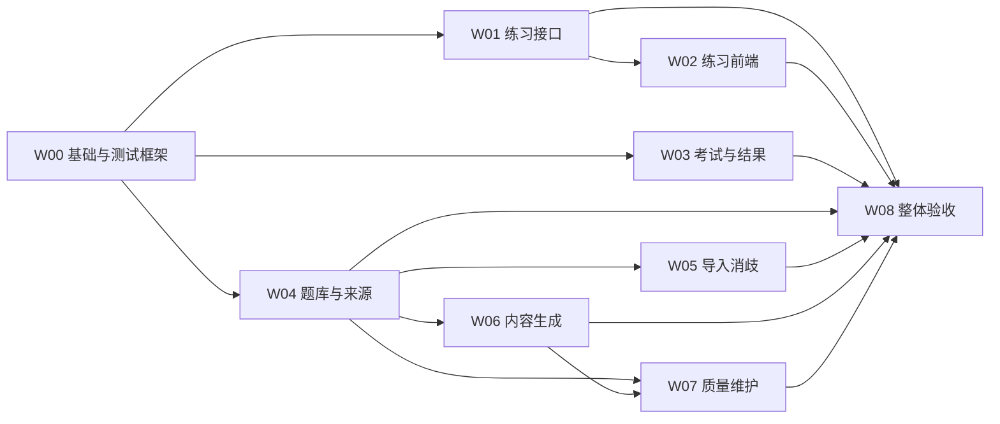

# Ant Design Web 前端模块实施计划

日期：2026-09-11。版本：`web-design-v1.1`。本次交付是校对后的设计与实施任务；九个 W 模块尚未实现，不代表已完成 Ant Design 接入。

配套文件：[交互设计](11-web-frontend-design.md)、[增量接口与 E2E 契约](13-web-api-and-e2e-contract.md)、[机器任务清单](../config/web-implementation-plan-v1.json)。旧 M00–M11 计划和冻结文件保留；新计划不沿用其 planned 状态推断现有代码是否完成。

## 1. 本次校对结论

| 问题 | 本次处理 |
| --- | --- |
| 原文中回看“需要接口”但没有确定调用方式 | 确定详情扩展、题卡状态分页、按 ordinal 读取已答题，由 W01 实现 |
| 回看可能直接混入 exposure_event 并改变解释 | 本版使用独立展示审计表；不更新评分、FSRS、冷却；未来策略变更另行版本化 |
| 未知提交没有具体恢复动作 | 定义不可变 outbox；练习以原请求重放确认，不猜测不存在的回执查询 |
| 题卡只列最近 30 条，上一题却可无限返回 | 明确每页 30 条、稳定分页、按 ordinal 读取；当前题可定位 |
| 提交后 cursor 与所看题号混用 | 分开 server cursor、activeQuestion、viewOrdinal；回看不发新题 |
| 生成/质量页依赖手填内部 ID | W04 提供版本发现，W06 提供任务/异常分页，W07 消费真实返回 ID |
| 练习、考试同时改共享组件 | W00 独占壳层/API transport/主题/通用展示组件，业务模块只适配 props |
| 只写 `make e2e` 无法证明每个模块能测 | 每模块登记具体 case、类型、fixture、进程和证据，缺一个必测 case 就不能通过 |
| 旧文档说部分命令待实现，但 Makefile 已有配方 | 既有 backend build/e2e 与新增 web-* 命令分开标注，不以旧文档代替代码事实 |
| 旧 M10 测试仍依赖提交按钮与旧快捷键 | W08 负责迁移旧浏览器用例并跑整体验收 |

## 2. 九个模块与依赖

“独立”指依赖完成后，能单独启动、单独用隔离数据完成真实业务 E2E。不是九个微服务，也不是每个模块各维护一套服务、登录或测试框架。

| 模块 | 交付内容 | 依赖 | 可独立验证的闭环 |
| --- | --- | --- | --- |
| W00 | 基础运行、共享组件与 E2E 框架 | 无新 W 依赖 | 构建资源 → 真实 Go → 浏览器首页/上下文/维护状态 |
| W01 | 练习恢复、历史、题卡与展示审计 API | W00 | HTTP 作答 → 刷新查询 → 历史回看记录 → SQLite 不变量 |
| W02 | 自适应练习前端 | W00、W01 | 开始 → 即点即答 → 自动/手动前进 → 回看 → 恢复 → 结束 |
| W03 | 阶段考试、持久事件队列与结果 | W00 | 组卷 → 选择/改选 → 同步 → 交卷 → 逐题结果 |
| W04 | 题库、来源与内容版本发现 | W00 | 创建题库 → 真实内容摘要 → 版本发现 → 管理生命周期 |
| W05 | 词表导入与歧义处理 | W00、W04 | 文件/文本 → 导入 → 分页消歧 → 题库实际成员变化 |
| W06 | 内容生成、任务与异常发现 | W00、W04 | 选择真实版本 → 任务 → 真实 worker → 发布/拒绝 |
| W07 | 质量处置、学习报告与维护 | W00、W04、W06 | 异常证据 → 处置记录/退役 → 重建状态 → 结果核对 |
| W08 | 集成、交付包装与全量回归 | W01–W07 | 完整日常流程、从构建产物启动、跨页面恢复与旧回归 |



推荐并行批次：W00 →（W01 / W03 / W04）→（W02 / W05 / W06，分别等待自己的依赖）→ W07 → W08。不是每批都必须等最慢者，满足本模块依赖即可启动实施。

## 3. 当前可用与待交付命令

本次已经提供的计划工具不启动服务：

```sh
make check-web-plan
make web-tasks
make web-task ID=W02
```

现有 Go 服务构建/启动方式：

```sh
make build
./bin/avocab serve --data-dir artifacts/manual/backend-baseline --listen 127.0.0.1:0 --seed core --policy config/policy-v2.json
make e2e MODULE=M00
```

下面是 W00 必须实现的新命令，当前不能将其描述为已可运行：

```sh
make web-build
make web-run MODULE=W02 DATA_DIR=artifacts/manual/W02 LISTEN=127.0.0.1:0
make web-e2e MODULE=W02
make web-e2e MODULE=all
```

web-run 负责检查已实现模块、依赖与构建 manifest，启动真实 Go，按模块准备测试内容/worker并输出实际 URL；数据目录默认新建，已存在目录只在明确 resume 模式下使用。初次演示使用静态内容 seed，不预写用户作答事实。缺实现或依赖时非零退出并列明缺项。

web-e2e 根据机器任务清单精确收集必测用例；不会因为旧 runner 的 `M*` 通配漏掉 W 模块。各模块验收都启动新服务进程和独立数据库，不要求先手工启动 web-run。

## 4. 文件所有权与协作协议

机器任务清单中的 owns 是唯一写入所有权；目录为整个子树，文件为单文件。计划校验器检查父子目录重叠、重复迁移、未知依赖和环。只读跨模块文件不受限制。

W00 统一拥有 `web/frontend/src/app/`、`api/`、`components/`、`theme/`、构建配置和锁文件。模块自己的 API DTO 与编排放在 `features/<name>/api.ts` 等本地文件，共享 client 只提供 transport、CSRF、错误结构和存储接口，不吸收业务状态机。

每个业务模块导出 `features/<name>/module.tsx`，包含稳定 id、路由和菜单描述。W00 使用构建时模块发现机制（例如 Vite glob）装配已存在模块；业务模块不改中央路由表。未实现模块不显示为可用功能，不渲染假业务数据。

共享组件至少提供 QuestionStem、PracticeOptions、ExamOptions、FeedbackPanel、AnswerSheet、SessionSyncStatus 的 props 契约。它们不持有业务请求、500ms 定时器或考试队列；W02/W03 用真实 DTO 适配。W00 在首批提供自己的组件/契约验收，不能把共享组件留到考试结果最后再实现，造成依赖环。

需要新增共享依赖或改共享接口时，由请求方提出具体兼容变更，W00 所有者在该模块交付前集成并重新跑 W00；不能等 W08 才接通模块，也不能多人同时改 package-lock。集成中不得回退他人变更。后端 handler 的读接口按 W01/W04/W06/W07 分包所有，禁止抢改同一 handler。

每次模块交付附：实现版本/提交、实际构建命令、入口 URL、用例结果路径、证据清单、已知限制。依赖模块须有完成记录；不能只写“已经合并”。

## W00 基础运行、共享组件与 E2E 框架

**目标：** 所有后续模块有同一套真实可启动底座，不需要各自搭服务器和浏览器。

- 所有权：前端构建配置/锁文件、app/api/components/theme、Go 静态资源接入、Makefile web 命令、新 web runner/harness、公共 fixture。精确文件见任务清单。
- 实现：锁定 Node/React/antd/Vite 与中文主题；构建静态 manifest；Go 选择已构建 SPA 路由，API 保持同源；正确处理 `/client-context`；IndexedDB outbox 基础与故障可见状态；动态模块装配；typed 共享展示组件；运行/测试进程监督及证据检查。
- Go 路由接入在本模块完成；后续模块添加自己的 descriptor 即可被构建发现。日常运行无需在线 Node 进程。
- 启动：`make web-run MODULE=W00 DATA_DIR=artifacts/manual/W00 LISTEN=127.0.0.1:0`，入口 `/`。
- E2E：`make web-e2e MODULE=W00`；数据为公共 core seed，浏览器从 Go URL 加载真实构建资源。
- 必测：W00-01 构建资源/路由/中文壳；W00-02 真实 context、CSRF、维护与活动会话；W00-03 outbox 存储重开/不可用反馈和共享控件键盘；W00-04 框架对零测试、缺证据、超时和未回收进程的拒绝。
- 完成：上述 case 全通过；每个 UI case 有 trace/截图/实际资源哈希；普通二进制不能暴露测试控制端点；W00 自身不依赖 W02/W03。

## W01 练习恢复、历史、题卡与展示审计 API

**目标：** 给练习前端一个足够完整且可恢复的真实契约。

- 所有权：`internal/practice/`、`migrations/100_practice_feedback_views.sql`、练习契约 fixture 与 W01 E2E；不改学习 eligibility/FSRS/cooling。
- 实现：按 13 文档扩展 session detail；题卡分页；单题已答读取；feedback-views 幂等审计；原 attempt 重放与恢复互相吻合；session/revision 的只读快照一致性。
- 启动：`make web-run MODULE=W01 DATA_DIR=artifacts/manual/W01 LISTEN=127.0.0.1:0`；API 入口 `/api/v1/health`，ready 中附该模块联调指引。
- E2E：`make web-e2e MODULE=W01`；真实 HTTP/SQLite。case fixture 提供至少 40 个可依次作答的合格目标和多形式内容，支持超过 30 条的题卡分页；所有 attempt 通过真实 API 产生。
- 必测：W01-01 作答后无 next 的完整恢复；W01-02 原请求重放/响应丢失/换选项冲突；W01-03 题卡分页、计数和 ordinal=0；W01-04 未答/跨会话/未来题防泄露；W01-05 展示审计幂等/原 key 换正文/延迟补交；W01-06 展示不改变 attempt、review、cursor、normal_position、冷却和统计投影。
- 完成：API 字段类型和错误码与 13 一致，DB 不变量可复核，现有 M03/M02 回归不因新增读/审计能力改变学习行为。

## W02 自适应练习前端

**目标：** 从进入题库到结束本轮的完整操作可在真实服务上独立验收。

- 所有权：`features/practice/`、W02 case/fixture；复用 W00 组件，消费 W01 API。
- 实现：数字即答、A/D 与题卡导航；server cursor/current/view 三层状态；500ms 自动前进和统一取消；正确/错误反馈；outbox 恢复；分页回看与展示审计队列；结束/无候选/维护。
- 启动：`make web-run MODULE=W02 DATA_DIR=artifacts/manual/W02 LISTEN=127.0.0.1:0`，入口 `/practice`。
- E2E：`make web-e2e MODULE=W02`；通过 API 准备题库，测试不依赖 W04 页面或 W05 导入页面已完成。
- 必测：W02-01 点击及1–4直接作答/防双击；W02-02 正确自动前进与 A/D、展开解析、隐藏页面取消；W02-03 错误持续停留/手动继续；W02-04 超过30题分页回看、原题返回、展示记录与计数；W02-05 真实已接受但响应丢失后的刷新恢复；W02-06 冷却/内容不足、活动冲突、维护与结束收敛。
- 完成：所有 PR-01–PR-23 由这些 case 覆盖；练习无提交按钮，数字不在回看态改答，字母 B/C 无作答行为。

## W03 阶段考试、持久事件队列与结果

**目标：** 考试与结果作为一个闭环交付，不依赖练习页面完成。

- 所有权：`features/exam/`、W03 case/fixture；既有 exam API 先不改业务语义。若发现后端缺陷，登记具体修复给其维护者，不绕过事件协议。
- 实现：组卷表单；完整题卡；选择/清除/改答事件；先持久后发送；unknown 原文重试、显式 not_accepted rebase、telemetry-gap；deadline；交卷屏障、放弃与结果页。
- 启动：`make web-run MODULE=W03 DATA_DIR=artifacts/manual/W03 LISTEN=127.0.0.1:0`，入口 `/exams/new`。
- E2E：`make web-e2e MODULE=W03`。
- fixture：合格固定试卷、可改答、无有效分母、作废题、可靠首次选择缺失；可通过受控测试准备形成边界，交卷必须来自真实服务。
- 必测：W03-01 固定题、1–4与A/D、clear/reselect及无提前答案；W03-02 unknown/rebase/顺序水位；W03-03 队列丢失与 gap；W03-04 有待确认操作时禁止越过交卷屏障；W03-05 deadline/迟到响应/放弃返回 submitted；W03-06 结果 null/void/首次历史及逐题解析。
- 完成：EX-01–EX-09 全覆盖，原始事件与实际最终答案一致；交卷前题卡绝不显示对错；结果失败不恢复可改答状态。

## W04 题库、来源与内容版本发现

**目标：** 用户通过真实界面选择题库，后续管理模块能获得合法版本 ID。

- 所有权：`features/banks/`、`internal/bank/` 新读接口（含挂载 `/api/v1/content/sense-versions` 与 `question-versions`）、W04 case/fixture。
- 实现：空态/创建/列表/详情/成员与归档；来源列表/登记；sense-version 和 question-version 发现；稳定分页/活动会话保护。词表文件解析归 W05。
- 启动：`make web-run MODULE=W04 DATA_DIR=artifacts/manual/W04 LISTEN=127.0.0.1:0`，入口 `/banks`。
- E2E：`make web-e2e MODULE=W04`；使用空库与 seed 库两套独立 case。
- 必测：W04-01 空态→建库/来源→列表；W04-02 详情/成员变更/CAS/归档；W04-03 真实版本发现与稳定分页；W04-04 活动作答期间管理保护和维护禁写。
- 完成：生成/质量所需 ID 均可由正式 API 发现，不暴露答案、不靠客户端拼造；可用题数不被误当成可组卷保证。

## W05 词表导入与歧义处理

**目标：** 导入到成员变化的完整流程独立可测。

- 所有权：`features/imports/`、W05 case/fixture；现有 importer API 作为基础。
- 实现：题库选择、粘贴/TXT/CSV/JSON、大小/行数校验、导入摘要、分页条目、采纳/排除、revision/幂等与错误恢复。
- 启动：`make web-run MODULE=W05 DATA_DIR=artifacts/manual/W05 LISTEN=127.0.0.1:0`，入口 `/imports`。
- E2E：`make web-e2e MODULE=W05`；真实文件含正常、歧义、重复、无法匹配及尺寸边界，不操作用户词表。
- 必测：W05-01 三种格式和2 MiB/5000行边界；W05-02 歧义分页/采纳多词义/排除；W05-03 CAS、幂等和已接受响应丢失；W05-04 任务汇总与题库成员真实一致。
- 完成：使用真实总数、无丢页；导入 sense_refs 为 ID 数组，与生成的对象数组分开定义。

## W06 内容生成、任务与异常发现

**目标：** 从选择内容版本到真实 worker 发布/拒绝，界面全程可追踪。

- 所有权：`features/generation/`、`internal/generation/handler.go` 及新增 web 查询文件、W06 case/fixture；不改 Python worker 的生成算法。
- 实现：版本选择、预算确认、创建/任务列表/详情/候选；新增任务分页和 quality-findings 稳定分页；清晰区分 pending、published、rejected、uncertain、pending_maintenance。
- 启动：`make web-run MODULE=W06 DATA_DIR=artifacts/manual/W06 LISTEN=127.0.0.1:0`，入口 `/generation`；监督器同时启动真实 worker 与本地确定性 provider。
- E2E：`make web-e2e MODULE=W06`；真实 worker/provider/checkpoint 独立目录，无付费调用。
- 必测：W06-01 真版本选择→202任务登记；W06-02 正/负候选真实处理与发布事实；W06-03 worker恢复/维护等待；W06-04 预算拒绝和失败文案；W06-05 任务/异常分页与活动会话保护。
- 完成：published 必须有正式题目版本事实，completed 不被解释为全部发布；UI 不展示服务凭证。

## W07 质量处置、学习报告与维护

**目标：** 质量动作的结果和影响可以在真实服务中核对。

- 所有权：`features/quality/`、`internal/revision/` 的必要接口修复、W07 case/fixture；读取 W04/W06 的发现接口，不改 generation handler。
- 实现：异常列表/详情、记录处置、证据 disposition、题目退役；学习摘要/详情；维护状态与失败指引；同步检查 HTTP 和业务 status。
- 启动：`make web-run MODULE=W07 DATA_DIR=artifacts/manual/W07 LISTEN=127.0.0.1:0`，入口 `/quality`；演示 fixture 可由 W06 真实 worker 产生异常。
- E2E：`make web-e2e MODULE=W07`；业务关键变更通过 UI/API，维护失败使用受控测试构建和独立库。
- 必测：W07-01 finding resolution 只记录处置、不假称发布；W07-02 retire 后不再选到该版本且旧事实保留；W07-03 disposition/rebuild 成功与 HTTP200业务失败；W07-04 活动会话保护/维护禁写；W07-05 学习报告样本条件、null和证据不足。
- 完成：没有当前404的修订发布按钮，没有虚构备份HTTP入口；原判定统计与有效学习证据口径清楚。

## W08 集成、交付包装与全量回归

**目标：** 证明九个模块组合后仍能以真实产品形式启动和使用。

- 所有权：`scripts/web_release.py`、包装配置、W08 case/fixture、旧 M10 用例适配、运行/验收文档；基础共享文件仍由 W00 所有者集成具体修复。
- 实现：完整模块 manifest；干净构建/分发检查；旧模板迁移收尾；无旧 controller 双挂载；资产缓存策略；从不同 cwd 启动；跨页面/刷新/重启恢复；旧 M10 适配新交互。
- 启动：`make web-run MODULE=W08 DATA_DIR=artifacts/manual/W08 LISTEN=127.0.0.1:0`，入口 `/`。
- E2E：`make web-e2e MODULE=W08`，最终另跑 `make web-e2e MODULE=all` 和 `make e2e MODULE=all`。
- 必测：W08-01 学习全链路；W08-02 导入→生成→质量→可用内容；W08-03 构建产物随Go交付、路径/重启恢复；W08-04 320/375/768/1024/1440、长文、键盘/输入法/弹层/焦点；W08-05 旧回归、新旧控制器隔离、测试路由边界与进程回收。
- 完成：所有必测模块有当前代码版本的通过证据；不会以某一个页面截图、组件测试或旧M10单独通过代替整个新版验收。

## 5. 全局完成标准

1. 任务所有必测 case 已实现并通过，真实进程/数据/浏览器证据齐全，失败或 skip 非零退出。
2. 干净依赖安装后按本模块命令可以启动，模块依赖已完成；没有占用用户已有服务/数据。
3. 对应 UI 路径没有 mock API、示例答案或只在测试中存在的假成功分支。
4. 操作结果与 SQLite/回执/生成事实关联一致，网络未知结果不被当成功或拒绝。
5. 共享变更已经由所有者集成，依赖调用与契约一致，旧冻结哈希未被无说明覆盖。
6. 任务清单状态更新有证据路径支持；计划 check 通过只代表计划完整，不代表应用或 E2E 通过。
