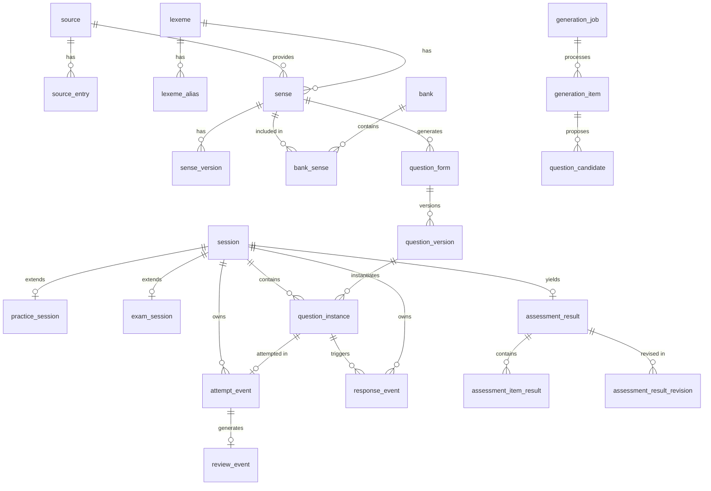

# 数据库 Schema 完整参考

## 1. 概述
- **SQLite 模式**: WAL (Write-Ahead Logging) mode, single writer + 4 read connections
- **Schema 版本**: 80 (migrations 000-080)
- **时间戳**: 所有的 Unix 时间戳均以微秒 (microseconds) 为单位，使用 `INTEGER` 类型存储
- **ID 格式**: 所有实体的主键 ID 均为 UUID 字符串，使用 `TEXT` 类型
- **外键约束**: 强制执行 (`PRAGMA foreign_keys = 1`)
- **同步模式**: `Synchronous = FULL`
- **繁忙超时**: 5000ms

## 2. 迁移版本历史
| 版本 | 文件 | 内容 |
| --- | --- | --- |
| 0 | `000_runtime.sql` | 运行时基础 |
| 10 | `010_content.sql` | 内容与题目 |
| 20 | `020_learning.sql` | 学习事件与投影 |
| 30 | `030_practice.sql` | 练习会话 |
| 40 | `040_exam.sql` | 考试会话与评分 |
| 50 | `050_import.sql` | 导入任务 |
| 60 | `060_generation.sql` | 内容生成 |
| 80 | `080_revision.sql` | 证据处置与重建 |

## 3. 表结构详解

### 3.1 运行时基础 (Migration 000)

#### `schema_migrations`
- **用途**: 跟踪数据库架构迁移历史。
- **主键**: `version`
- **列**:
  - `version` (INTEGER): 迁移版本号
  - `name` (TEXT, NOT NULL): 迁移脚本名称
  - `applied_at` (INTEGER, NOT NULL): 应用时间戳

#### `session`
- **用途**: 用户交互会话的基础记录（练习或考试）。
- **主键**: `id`
- **列**:
  - `id` (TEXT): 会话 ID
  - `kind` (TEXT, NOT NULL): 会话类型。CHECK: `('practice', 'exam')`
  - `status` (TEXT, NOT NULL): 状态。CHECK: `('open', 'ended', 'submitted', 'abandoned')`
  - `bank_id` (TEXT): 关联词库 ID
  - `cursor` (INTEGER, NOT NULL): 进度指针，默认 `0`
  - `normal_position` (INTEGER): 正常位置
  - `revision` (INTEGER, NOT NULL): 修订版本号，默认 `0`
  - `last_ack_sequence` (INTEGER, NOT NULL): 最后确认序列，默认 `0`
  - `deadline_at` (INTEGER): 截止时间
  - `created_at` (INTEGER, NOT NULL): 创建时间
  - `updated_at` (INTEGER, NOT NULL): 更新时间
- **索引**: 
  - `uq_session_active`: 唯一部分索引 `( (1) ) WHERE status = 'open'`。确保全局最多只有一个开启的会话。

#### `idempotency_record`
- **用途**: 记录 API 调用的幂等性结果。
- **主键**: `(operation, resource_scope, key)`
- **列**:
  - `operation` (TEXT, NOT NULL): 操作名称
  - `resource_scope` (TEXT, NOT NULL): 资源作用域
  - `key` (TEXT, NOT NULL): 幂等性键值
  - `request_digest` (TEXT, NOT NULL): 请求摘要
  - `status` (TEXT, NOT NULL): 处理状态
  - `response_code` (INTEGER, NOT NULL): HTTP 响应码
  - `response_body` (TEXT, NOT NULL): 响应体
  - `created_at` (INTEGER, NOT NULL): 创建时间

#### `projection_control`
- **用途**: 控制投影的全局状态（单行记录）。
- **主键**: `id` CHECK `(id = 1)`
- **列**:
  - `id` (INTEGER): 固定为 `1`
  - `mode` (TEXT, NOT NULL): 模式，默认 `'active'`。CHECK: `('active', 'rebuilding')`
  - `active_version` (TEXT, NOT NULL): 当前激活的投影版本，默认 `'v1'`
  - `run_id` (TEXT): 关联的重建运行 ID
  - `run_status` (TEXT): 运行状态
  - `requires_rebuild` (INTEGER, NOT NULL): 是否需要重建，默认 `0`
  - `fixed_watermark` (INTEGER, NOT NULL): 固定水位线，默认 `0`
  - `updated_at` (INTEGER, NOT NULL): 更新时间

#### `global_sequence`
- **用途**: 全局事件排序与定序生成。
- **主键**: `seq` (AUTOINCREMENT)
- **列**:
  - `seq` (INTEGER): 自动递增序列
  - `event_name` (TEXT, NOT NULL): 事件名称
  - `created_at` (INTEGER, NOT NULL): 创建时间

---

### 3.2 内容与题目 (Migration 010)

#### `source`
- **用途**: 词汇内容的来源定义。
- **主键**: `id`
- **列**:
  - `id` (TEXT)
  - `name` (TEXT, NOT NULL)
  - `location` (TEXT, NOT NULL)
  - `source_version` (TEXT, NOT NULL)
  - `license` (TEXT, NOT NULL)
  - `usage_scope` (TEXT, NOT NULL)
  - `checksum` (TEXT)
  - `revision` (INTEGER, NOT NULL): 默认 `0`
  - `created_at` (INTEGER, NOT NULL)
  - `updated_at` (INTEGER, NOT NULL)

#### `source_entry`
- **用途**: 数据源中的原始词条。
- **主键**: `id`
- **外键**: `source_id -> source(id)`
- **唯一约束**: `(source_id, source_version, external_entry_id)`
- **列**: `id`, `source_id`, `source_version`, `external_entry_id`, `raw_word`, `raw_translation`, `pos`, `tags`, `aliases`, `statistics`, `created_at`

#### `lexeme`
- **用途**: 基本词位（标准形）。
- **主键**: `id`
- **唯一约束**: `canonical_form`
- **列**: `id`, `canonical_form` (TEXT, NOT NULL), `created_at`

#### `lexeme_alias`
- **用途**: 词位的别名或变形。
- **主键**: `id`
- **外键**: `lexeme_id -> lexeme(id)`
- **唯一约束**: `form`
- **列**: `id`, `form` (TEXT, NOT NULL), `lexeme_id`, `created_at`

#### `sense`
- **用途**: 词位的特定词义和词性。
- **主键**: `id`
- **外键**: `lexeme_id -> lexeme(id)`, `source_id -> source(id)`
- **列**: `id`, `lexeme_id`, `part_of_speech`, `source_id`, `created_at`

#### `sense_version`
- **用途**: 词义的版本化内容。
- **主键**: `id`
- **外键**: `sense_id -> sense(id)`
- **唯一约束**: `(sense_id, version_number)`
- **列**: `id`, `sense_id`, `meaning`, `frequency`, `version_number` (默认 1), `created_at`

#### `bank`
- **用途**: 词库（单词本）。
- **主键**: `id`
- **列**: `id`, `name`, `note`, `archived` (CHECK 0 or 1), `revision`, `created_at`, `updated_at`

#### `bank_sense`
- **用途**: 词库与词义的关联（多对多）。
- **主键**: `(bank_id, sense_id)`
- **外键**: `bank_id -> bank(id)`, `sense_id -> sense(id)`
- **列**: `bank_id`, `sense_id`, `added_at`

#### `option_identity`
- **用途**: 题目的选项实体。
- **主键**: `id`
- **唯一约束**: `canonical_key`
- **外键**: `sense_id -> sense(id)`, `source_id -> source(id)`
- **列**: `id`, `canonical_key`, `language`, `normalized_text`, `sense_id`, `source_id`, `source_version`, `created_at`

#### `question_form`
- **用途**: 题目的规范形式模板。
- **主键**: `id`
- **唯一约束**: `dedup_hash`
- **外键**: `sense_id -> sense(id)`
- **列**: `id`, `sense_id`, `task_family` (CHECK: `meaning_recognition`, `reverse_selection`, `context_selection`), `dedup_hash`, `normalized_stem`, `created_at`

#### `question_version`
- **用途**: 具体的题目实例化版本。
- **主键**: `id`
- **外键**: `form_id -> question_form(id)`, `sense_id -> sense(id)`, `sense_version_id -> sense_version(id)`
- **列**: `id`, `form_id`, `sense_id`, `sense_version_id`, `task_family`, `stem`, `options_json`, `correct_option_id`, `explanation`, `candidate_id`, `status` (默认 'published'), `revision`, `created_at`, `updated_at`
- **索引**: `idx_question_version_unit_lookup` on `(sense_id, task_family, status, created_at)`

#### `question_instance`
- **用途**: 会话中实际出题实例。
- **主键**: `id`
- **外键**: `session_id -> session(id)`, `question_version_id -> question_version(id)`
- **唯一约束**: `(session_id, ordinal)`
- **列**: `id`, `session_id`, `ordinal`, `normal_position`, `question_version_id`, `snapshot_json`, `created_at`

---

### 3.3 学习事件与投影 (Migration 020)

#### `attempt_event`
- **用途**: 记录一次完整的作答尝试。
- **主键**: `id`
- **外键**: `instance_id` (UNIQUE), `session_id`, `sense_id`, `event_sequence -> global_sequence(seq)`
- **重要 CHECK 约束**: `source` (practice/exam), `purpose`, `response_history`, `task_family`, `is_correct` (0/1).
- **索引**: `idx_attempt_event_cooldown`

#### `response_event`
- **用途**: 客户端发生的交互响应事件。
- **主键**: `id`
- **唯一约束**: `(session_id, client_event_id)`, `(session_id, client_sequence)`
- **外键**: `session_id`, `instance_id`, `event_sequence`
- **重要列**: `action` (select/clear/noop), `option_id`, `expected_revision`, `accepted_revision`

#### `exposure_event`
- **用途**: 用户的曝光事件记录。
- **主键**: `id`
- **外键**: `source_instance_id`, `sense_id`, `lexeme_id`, `form_id`, `event_sequence`
- **唯一约束**: 针对 kind 在 reserved 或 feedback_available 的局部唯一 `uq_exposure_instance_kind`
- **索引**: `idx_exposure_lookup`, `idx_exposure_event_cooldown`

#### `review_event`
- **用途**: 基于尝试生成的 FSRS 复习调度事件。
- **主键**: `id`
- **唯一约束**: `(attempt_id, observation_policy_version)`
- **外键**: `attempt_id`, `sense_id`
- **列**: 包含大量 FSRS 相关的浮点与整数状态指标（`rating`, `stability`, `difficulty`, `due_at` 等）

#### `event_revision`
- **用途**: 记录事件的修正状态。
- **主键**: `id`
- **列**: `event_id`, `event_type`, `revision_kind`, `reason`, `created_at`

#### `evidence_projection`
- **用途**: 投影视图：证据统计聚合。
- **主键**: `(projection_version, sense_id, task_family)`
- **列**: 各种情况的 samples 和 correct 统计, `needs_consolidation`, `applied_event_sequence`, `updated_at`

#### `memory_projection`
- **用途**: 投影视图：当前 FSRS 记忆状态聚合。
- **主键**: `(projection_version, sense_id, task_family)`
- **列**: 包含最新的 FSRS 计算状态 (`fsrs_state`, `stability`, `difficulty`, 等)

#### `confusion_projection`
- **用途**: 投影视图：混淆项（易错项）统计。
- **主键**: `(projection_version, target_sense_id, task_family, distractor_identity_id, stat_group)`
- **列**: `eligible_offered_count`, `wrong_selected_count`, `last_offered_at`, `last_selected_at`

#### `correction_item`
- **用途**: 待进行的错题纠正项记录。
- **主键**: `(session_id, sense_id, task_family)`
- **列**: `triggering_attempt_id`, `triggering_event_sequence`, `status` 等

---

### 3.4 练习会话 (Migration 030)

#### `practice_session`
- **用途**: 练习模式特有的会话状态。
- **主键**: `session_id` (REFERENCES `session(id)`)
- **外键**: `bank_id -> bank(id)`
- **列**: `unresolved_unit_count`, `created_at`, `updated_at`
- **索引**: `idx_practice_session_bank`

---

### 3.5 考试 (Migration 040)

#### `exam_session`
- **用途**: 考试模式特有的会话状态。
- **主键**: `session_id` (REFERENCES `session(id)`)
- **外键**: `bank_id -> bank(id)`
- **列**: `question_count`, `time_limit_seconds`, `deadline_at`, `task_quotas_json`, `tags_json`, `telemetry_incomplete`, `assembly_seed`
- **索引**: `idx_exam_session_bank`

#### `exam_instance_draft`
- **用途**: 考试进行中题目的临时选择状态草稿。
- **主键**: `(session_id, instance_id)`
- **列**: 包含各个关键交互节点的选项和版本信息

#### `assessment_result`
- **用途**: 考试结束后生成的整体评估结果。
- **主键**: `id`
- **唯一约束**: `session_id` (REFERENCES `session(id)`)
- **列**: `total_count`, `correct_count`, `omitted_count`, `void_count`, `ratio`, `result_revision`

#### `assessment_item_result`
- **用途**: 考试后单道题目的评分记录。
- **主键**: `id`
- **外键**: `assessment_id`, `instance_id`, `sense_id`
- **列**: `selected_option_id`, `correct_option_id`, `is_correct`, `response_history`, `first_correct`

---

### 3.6 导入 (Migration 050)

#### `import_job`
- **用途**: 处理外部内容导入的批次任务。
- **主键**: `id`
- **列**: `target_type` (source/bank), `target_id`, `status`, `resolution_policy_version`，及各项处理计数器
- **索引**: `idx_import_job_target`

#### `import_item`
- **用途**: 导入批次中的具体单项记录。
- **主键**: `id`
- **唯一约束**: `(import_id, ordinal)`
- **列**: `raw_input`, `status`, `candidates_json`, `resolved_sense_ids_json`
- **索引**: `idx_import_item_status`

---

### 3.7 内容生成 (Migration 060)

#### `generation_job`
- **用途**: AI 自动生成题目的批次任务。
- **主键**: `id`
- **外键**: `bank_id`

#### `generation_item`
- **用途**: 生成任务中单个词义的生成项与排他锁状态。
- **主键**: `id`
- **外键**: `job_id`, `bank_id`, `sense_id`, `sense_version_id`
- **列**: `status`, `lease_owner`, `lease_until`, `fencing_token`

#### `generation_budget_ledger`
- **用途**: 生成任务对应的配额和 Token 消耗账本。
- **主键**: `job_id`
- **列**: `max_requests`, `max_tokens`, `authorized_requests`, `total_tokens`, `budget_overrun`

#### `generation_call`
- **用途**: 对底层 AI/大模型提供商的请求调用记录。
- **主键**: `reservation_id`
- **唯一约束**: `(job_id, network_attempt_id)`
- **列**: `stage`, `input_tokens`, `output_tokens`, `status`, `outcome` 等

#### `question_candidate`
- **用途**: AI 生成出的候选题目，等待验证和采纳。
- **主键**: `id`
- **唯一约束**: `(item_id, attempt_number, candidate_index)`
- **列**: `content_json`, `disposition` (published/rejected 等)

#### `quality_finding` 与 `quality_finding_resolution`
- **用途**: 记录题目质量检查的异常发现与处置策略。

---

### 3.8 证据处置与重建 (Migration 080)

#### `model_rebuild_run`
- **用途**: 执行数据投影或学习模型历史重建的任务。
- **主键**: `id`
- **唯一约束**: `predecessor_run_id`
- **列**: `kind`, `base_active_version`, `status`, `requires_rebuild` 等

#### `evidence_disposition`
- **用途**: 题目失效或发生争议时，对应证据的失效裁定。
- **主键**: `id`
- **外键**: `question_version_id`, `rebuild_run_id`

#### `assessment_result_revision`
- **用途**: 考试评估因部分题目失效或纠正导致的修订历史。
- **主键**: `id`
- **唯一约束**: `(assessment_id, result_revision)`

---

## 4. 实体关系图

## 5. 重要约束与不变量

1. **单活跃会话 (Single Active Session)**
   数据库中通过在 `session` 表上定义唯一的部分索引 (`UNIQUE INDEX uq_session_active ON session( (1) ) WHERE status = 'open'`)，严格保证全系统在同一时刻最多只能存在一个处于 `open` 状态的会话，无论是考试还是练习模式。
   
2. **事件全局定序 (Event Ordering)**
   系统中的所有事件均依赖 `global_sequence` 表维持其逻辑发生顺序。诸如 `attempt_event`, `exposure_event` 等均持有 `event_sequence` 引用，用于后续数据恢复和投影更新。
   
3. **投影版本控制 (Projection Versioning)**
   `evidence_projection`、`memory_projection` 和 `confusion_projection` 三大聚合宽表都基于 `projection_version` 进行版本隔离。在触发重大迁移或历史重建时，可以并行写入新的版本而不影响当前活跃版本的读取，由 `projection_control` 指导切换。
   
4. **幂等性控制 (Idempotency Scope Rules)**
   客户端的 API 调用可以通过 `idempotency_record` 拦截重放。请求通过 `(operation, resource_scope, key)` 共同锁定其唯一性。只有处理结果成功记录的调用，再次重放时会直接返回已存储的 `response_body` 和状态码。
   
5. **强类型枚举限制 (Enum Check Constraints)**
   所有被作为状态机或者枚举型的字段（如 `status`, `kind`, `task_family`, `action`），在建表时均附加了严格的 `CHECK (col IN (...))` 约束，保障在多端并发写入时的脏数据隔离能力。
