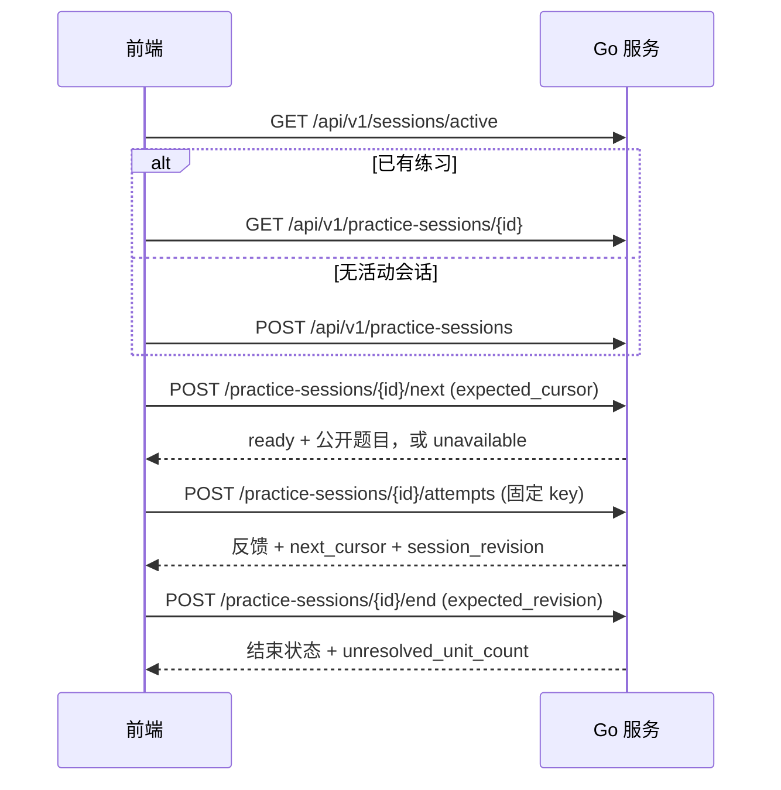

# 前端接口联调指南

适用版本：当前仓库实现，核对日期 2026-09-09。本文面向页面开发、独立前端接入和联调；覆盖浏览器使用的 JSON / multipart 接口，不包含 worker 内部协议。

[HTTP v1 冻结契约](08-http-contract.md)保留设计要求；本文描述当前可调用的接口与兼容事项，不修改冻结契约。字段与实际行为不一致时，参见本文的[实现差异](#实现差异与暂不可用能力)，不要通过省略版本号或改变重试正文绕过约束。

## 文档导航

- [接口与字段参考](frontend-api-reference.md)：全部 39 个业务 HTTP 方法/路径组合，含练习 abandon 别名。
- [可复用浏览器请求示例](examples/frontend-client.mjs)：CSRF、错误封装、固定幂等正文；不自动重试写操作。
- [联调演练脚本](examples/frontend-api-walkthrough.py)：启动正式二进制，在临时目录执行请求并核对响应。
- [后端回归矩阵](e2e-backend-regressions.md)：并发、截止时间、进程恢复和重复提交的测试证据。
- [运行手册](runbook.md)：本地启动、备份和维护 CLI。

## 先接通服务

```sh
make build
./bin/avocab serve --data-dir data/local --listen 127.0.0.1:8080 --seed core
```

浏览器页面与 API 使用同一 origin，例如 `http://127.0.0.1:8080`。JSON 接口通常以 `/api/v1` 开头，**获取浏览器上下文的实际路径是 `GET /client-context`**。`GET /api/v1/client-context` 不是已注册接口。

建议初始化顺序：

1. `GET /api/v1/health`，检查服务可用。
2. `GET /client-context`，缓存返回的 `csrf_token`；Cookie 由浏览器管理。
3. `GET /api/v1/maintenance`，决定是否允许开始或提交业务写入。
4. `GET /api/v1/sessions/active`，优先恢复活动会话。
5. `GET /api/v1/banks`，展示题库摘要；按需要进入练习、考试或内容管理。

### 地址、Cookie 与 CSRF

| 项目 | 前端约定 |
| --- | --- |
| Origin | 使用同源相对路径。服务只接受 `127.0.0.1` / `localhost` Host；当前没有跨域 CORS 接入配置，不应直接从另一个开发端口跨域请求 |
| Cookie | `/client-context` 签发或复用 `avocab_session`，属性为 HttpOnly、Path=/、SameSite=Lax；本地 HTTP 下 Secure=false。不要用 JS 读取或保存 Cookie |
| GET | 建议 `credentials: 'same-origin'`、`cache: 'no-store'`、`Accept: application/json` |
| 写操作 | 发送 Cookie、`X-CSRF-Token`；JSON 正文加 `Content-Type: application/json` |
| 重启后 | CSRF 签名密钥随服务启动更新。收到明确的 `403 CSRF_REJECTED` 后重新获取 `/client-context`，保留待提交的业务标识和正文 |
| 排查 | 可传 `X-Request-ID`；服务返回 `X-Request-Id`，错误体含 `error.request_id` |
| worker | `/internal/v1/generation/*` 是 worker 协议。不要把 `worker.token` 放入浏览器、静态文件或前端配置 |

### 格式、大小与空值

- JSON 使用 UTF-8；成功响应直接返回业务对象，没有统一的 `data` 外壳。
- 当前全局请求正文上限为 **2 MiB**，包括 multipart 边界和其他字段。上传文件要留出表单开销；当前词表上限为 **5000 行/项**，有效 UTF-8。
- 日期存在两种表示：普通资源的 `created_at` / `updated_at`、活动会话的 `deadline_at`、学习状态的 `due_at` 为 **Unix 微秒整数**；考试公开对象的 `deadline` 为 **RFC 3339 UTC 字符串**。
- 微秒转换：`new Date(Math.trunc(value / 1000))`；考试截止时间：`new Date(deadline)`。不要直接把微秒传入 `new Date(value)`。
- `0` 是有效的 revision、cursor、ordinal、sequence 初始值，使用 `??` 判断缺失，避免 `value || fallback`。
- 未设置的部分字段被省略；未选择答案的 `selected_option_id`、结果的 `first_correct` / `ratio` 则可能明确为 `null`。部分空 slice 可能序列化为 `null`，列表渲染使用 `items ?? []`。
- 三种题型仅为 `meaning_recognition`、`reverse_selection`、`context_selection`。
- 只提交接口定义的字段。当前部分 handler 对未知字段/重复 JSON key 的校验不严格，不能据此扩展请求协议。

## 错误、并发与重试

统一错误对象通常为：

```json
{
  "error": {
    "code": "REVISION_CONFLICT",
    "message": "状态已更新",
    "request_id": "9786e207-bb31-46ec-9464-0d68f136631d",
    "details": {
      "current_revision": 7,
      "last_ack_sequence": 4,
      "acceptance": "not_accepted"
    }
  }
}
```

`details` 可省略，字段按错误类型出现；不要假定任何 409 都有 `acceptance`，也不要假定所有非 2xx 都能解析出 JSON（例如未知路径或默认路由错误）。`message` 用于展示，控制流依据 `status`、`code` 与明确返回的 `details`。

| HTTP / code | 前端处理 |
| --- | --- |
| 400 INVALID_REQUEST / BANK_ARCHIVED | 校正输入或重新选择题库。当前超大导入也可能返回 400 INVALID_REQUEST，不要只捕获 413 |
| 401 UNAUTHORIZED | 浏览器不使用 worker bearer token；检查是否误带 Authorization |
| 403 CSRF_REJECTED / ORIGIN_REJECTED | 重新建立浏览器上下文或修正同源访问；不能换业务幂等键来解决 |
| 404 NOT_FOUND | 资源或回执未找到；回执 404 不证明另一个仍在途的请求最终不会成功 |
| 409 SESSION_ACTIVE | 查询活动会话，显示“继续练习/继续考试”；内容管理详情也可能因防泄题返回此错误 |
| 409 SESSION_CLOSED / EXAM_SUBMITTED | 重新读取会话；考试为 submitted 时读取结果，abandoned 时返回题库/考试入口 |
| 409 ALREADY_ANSWERED | 练习不允许改选覆盖原答案；恢复会话并使用已有反馈 |
| 409 IDEMPOTENCY_CONFLICT | 同一个 key 曾成功绑定另一正文；检查本地操作队列，不能换新 key 掩盖冲突 |
| 409 REVISION_CONFLICT | 读取资源最新版本；练习 next 参考 `details.cursor`。考试事件只有明确 `acceptance=not_accepted` 才允许重排 |
| 409 EVENT_SEQUENCE_GAP / EVENT_SEQUENCE_CONFLICT | 按考试事件恢复流程处理，不静默丢弃本地动作 |
| 422 EXAM_CONSTRAINT_UNSATISFIED / ASSEMBLY_LIMIT_REACHED | 调整题数或题型配额；分别表示无可行试卷或搜索达到上限 |
| 428 PRECONDITION_REQUIRED | 补充正确的版本、游标或交卷水位，不能硬编码为 0 |
| 503 MAINTENANCE | 停止新写入，轮询维护状态。维护中全局中间件也会拦截已成功操作的 POST 重试 |
| 500 INTERNAL_ERROR / DATABASE_ERROR | 保留待确认操作、展示 request_id；当前部分业务输入错误也会映射为 500，避免无上限自动重试 |
| 网络断开 / 超时 / AbortError | 接受状态未知；保留原 key、正文、序号和版本，不能标记“未保存”后自动创建新操作 |

### 幂等 key 与 revision 各自负责什么

一个用户动作创建一次 `Idempotency-Key`，建议 `crypto.randomUUID()`，然后将 **路径 + 正文 + key** 一起保留。重试重新建立网络请求，但复用已保存的三者。

`expected_revision` 是资源版本 CAS；`expected_cursor` 是练习发题游标；`client_sequence` 是考试动作顺序。它们不能替代幂等键。不同资源的 revision 不能混用：题库操作用 bank.revision，导入处置用 item.revision，练习结束用 session.revision，考试事件用 session_revision。

| 当前实现的重放能力 | 接口 |
| --- | --- |
| 要求 key，保存回执 | 创建来源、创建题库、移除成员、归档题库、创建生成任务 |
| 支持 key，但 handler 未强制要求 | 来源/词表导入、导入条目处置、创建练习、练习作答、结束/放弃练习、创建考试、遥测缺口、证据处置；新前端仍应始终发送 key |
| 正文 ID 用作 key，并检查非空 Header 与其相同 | 考试 response-events 的 `client_event_id`；submit 的 `submission_id`。前端同时发送且保持一致 |
| 依赖当前游标已有实例 | 练习 next：重复同一有效 cursor 返回同一未答实例，未实现通用 Header 回执 |
| 尚无持久化幂等回执 | 考试 abandon、题目 retire、quality-finding resolution。未知结果时先查资源状态，不直接按“支持幂等”盲重试 |

命中 `Idempotent-Replayed: true` 可用于调试，但来源创建、导入、练习创建/业务重复答题和遥测缺口等路径不一定返回该 Header。**缺少此 Header 不代表产生了第二份副作用。** 新 key 也不能越过“一个实例只能首次作答”“一个考试只有一份提交结果”等业务唯一约束。

## 页面调用流程

### 练习



图中省略的 API 前缀为 `/api/v1`。

初始 `cursor=0`、`revision=0`、`normal_position=1`。保留题目不等于作答，不递增 cursor；接受作答后使用反馈的 `next_cursor` 和 `session_revision` 更新本地状态。`next` 返回零值字段时可能省略它们，保持已有的 0 即可。

恢复详情优先显示 `current_question`；`last_feedback` 若存在，仅展示其原反馈。无候选是 `200 {status:"unavailable"}`，不是服务故障，也不会自动结束会话。前端应显示原因和等待/结束选项。

### 考试事件与交卷

1. 创建考试后保存 `exam_id`，读取详情，初始化 revision 和 `last_ack_sequence`。题目与选项在本次考试中固定。
2. 用户 select/clear 时，先把完整操作存入本地待发送队列；第一笔事件序号是 1。只发送队首，避免自己的多个事件争用同一 revision。
3. `200` 后保存 `accepted_sequence`、`current_revision`、返回草稿，再移除队首。任何“已保存”标记都应以服务端确认水位为依据。
4. 网络错误保持原正文重试。需要查询时使用事件回执接口；未查到回执时仍需处理在途请求的不确定性。
5. 只有明确 `acceptance=not_accepted` 时，才读取最新考试详情重排 revision/sequence；保留原 `client_event_id`、instance/action/option，并附 `rebased_from`。最多自动重排 3 次，之后等待显式处理。
6. 本地队列丢失时先完成 `telemetry-gaps` 的 CAS 屏障，再从返回的 `last_ack_sequence + 1` 发送新动作。
7. 手动交卷前确认队列已清空且没有 unknown/rejected 项；发送当前 revision、已确认水位和固定的 submission_id。
8. `result_url` 是 HTML 页面地址 `/exams/{id}/result`；读取结果 JSON 使用 `/api/v1/exams/{id}/result`。

倒计时只是 UI 展示，服务端 deadline 决定可接受的动作。迟到 response-event 会触发持久化自动交卷并返回 `409 EXAM_SUBMITTED`；过期的 submit 返回已交卷结果并使用不完整遥测语义。放弃请求到达时若已经过期，也可能返回 `status=submitted`，前端必须检查响应状态。不要假设 GET 详情会主动结算所有到期考试，也不要把 SESSION_CLOSED 一律当作 submitted。

### 导入与质量管理

来源登记 → 来源条目导入 → 词表导入题库 → 查询条目 → 采纳/排除歧义 → 刷新题库摘要。词表导入同步返回 `completed` 和统计，读取 items 用 `limit/offset`。注意两个接口同名 `sense_refs` 的形状不同：导入处置为 **sense ID 字符串数组**，创建生成任务为 **{sense_id,sense_version_id} 对象数组**。

证据处置要求无活动会话，响应返回 disposition/rebuild 标识；当前会同步执行重建，但 HTTP 200 的业务 `status` 仍可能为 `failed`。收到响应后同时检查业务状态与 `/api/v1/maintenance`，不要仅凭 200 显示“重建完成”。

全局维护模式为 `active` / `rebuilding`。当前所有公开业务写请求先经过维护中间件，服务层的幂等查询优先级不能绕过这一闸门；已有成功操作的 POST 重试也可能暂时收到 503。维护状态恢复后再按原操作重试。

## 实现差异与暂不可用能力

下表是联调限制，不是鼓励调用这些边界行为。本文不会把未完成的行为描述为已经支持。

| 项目 | 当前行为与接入建议 |
| --- | --- |
| 日期 | 普通资源为微秒、考试 deadline 为 RFC 3339；按字段转换 |
| 分页 | sources/banks 返回全部；import items 使用 offset；quality-findings 只有 limit，尚无可推进的 next_cursor |
| 导入大小 | 当前 2 MiB / 5000 行；冻结设计中的 5 MiB / 10000 行不适用于当前实现 |
| 导入请求 | JSON 省略 expected_revision 会得到默认 0；multipart 省略时可能跳过 CAS。前端应显式发送真实 revision；不发送负数绕过检查 |
| source_refs | 词表 JSON 虽接受 string[]，当前没有据此限制来源匹配；不要把它作为已实现的来源筛选功能 |
| 版本字段 | 部分考试/管理请求使用普通整数，后端无法区分缺失与 0；前端仍必须完整发送，不依赖后端总能返回 428 |
| 遥测字段 | 练习时长字段为 `client_active_duration_ms`。当前考试事件 DTO 不接收练习 telemetry 对象 |
| 重放 | abandon / retire / finding resolution 尚无通用回执，部分其他接口缺少重放 Header，按上方能力表处理 |
| 未实现接口 | `POST /api/v1/question-versions/{id}/revisions` 当前返回 404；不能据冻结文档启用修改内容发布按钮 |
| 管理发现能力 | 当前没有题目版本列表 JSON、sense-version 列表 JSON、生成任务列表 JSON、重建运行详情 JSON 等接口；现有页面有些标识由服务端模板注入。独立前端不能凭空拼造 ID |
| finding resolution | 当前只保存 resolution 记录、标记 finding 已解决；不能将 200 解释为内容已修改、任务已重建或题目已恢复有效 |
| 防泄题 | bank 详情、candidate 详情、sense 学习详情在活动会话期间会拒绝读取。前端也不要预取/缓存答案或带解析的管理对象 |
| 开发辅助路由 | 当前二进制注册了 `/api/v1/test/action`、`/api/v1/test/questions`；不纳入前端业务接口，不将其用作内容生产入口 |
| 维护/备份 | 重建恢复、备份与灾难恢复使用运行手册中的 CLI；不存在可据此推导的任意 POST /maintenance 或备份 HTTP API |

现有页面脚本还存在以下接入缺口，本文提供的推荐流程不代表这些页面已全部实现：

- 导入上传/处置和练习结束没有发送它们本可使用的幂等键。
- 考试的 telemetry-gap helper 已定义，但当前页面流程没有实际触发；交卷不能仅以 `processQueue()` Promise 已返回判定队列全部确认。
- Shell 的活动考试链接使用 `/exam`，实际页面路由是 `/exams/{id}`；放弃考试后页面也应处理服务端返回 submitted 的分支。

## 联调验收清单

在仓库根目录执行文档演练：

```sh
make build
.tools/uv/bin/uv run --directory e2e --locked python ../docs/examples/frontend-api-walkthrough.py
# 已安装项目 Chromium 时，同时验证浏览器 helper
.tools/uv/bin/uv run --directory e2e --locked python ../docs/examples/frontend-api-walkthrough.py --browser
```

脚本使用临时数据目录，结束后关闭服务并清理临时库，HTTP 脱敏结果保存在 `artifacts/frontend-api/run_*/result.json`。它覆盖初始化、来源/词表导入、分页和消歧、题库变更、练习反馈与重放、考试事件/回执/遥测缺口/交卷；不是对全部管理端点的穷举测试，不启动 worker 或调用模型。

浏览器 helper 是供复制到前端工程的示例模块；当前服务不提供 `/docs` 静态路径。引入后按以下方式使用：

```js
import { initializeContext, getJSON, prepareWrite, sendPrepared } from './frontend-client.mjs';
await initializeContext();
const { data: active } = await getJSON('/api/v1/sessions/active');
const pending = prepareWrite('/api/v1/practice-sessions', { bank_id: selectedBankId });
// 在适当的本地队列保存 pending；未知结果时仍发送同一个 pending。
const { data, status } = await sendPrepared(pending);
```

helper 不自动重试写入，不把网络异常解释为服务端未提交，也不会使本身缺少幂等支持的接口获得幂等能力。未说明单位的可选遥测字段先省略。

- 同源 Cookie/CSRF 正常；服务重启后可刷新上下文，业务待提交操作不丢失。
- 未提交前只渲染 `PublicQuestion`，不从管理接口补查答案。
- 练习处理 ready/unavailable、旧 cursor、重复提交、结束后恢复；空字段和 0 不混淆。
- 考试覆盖 select→clear→select、重复事件、明确拒绝重排、断线重试、队列丢失、deadline、未答交卷、结果 ratio/first_correct 为 null。
- 导入分别验证 TXT、CSV、JSON words/text、中文错误提示、超限、offset 分页，以及 sense_refs 的字符串数组格式。
- 维护中禁用新业务写入；证据处置返回 failed 时仍显示后续维护动作。
- 发现文档与实际响应不一致时，保留方法/路径、状态码、请求标识和脱敏正文；不记录 Cookie、CSRF、worker token。

维护本文时，同时核对对应模块的 `handler.go`、`types.go`、service 及 [web/static](../web/static)，并运行联调演练。不要直接将含 `sql.Null*` 的数据库结构作为 HTTP DTO。
